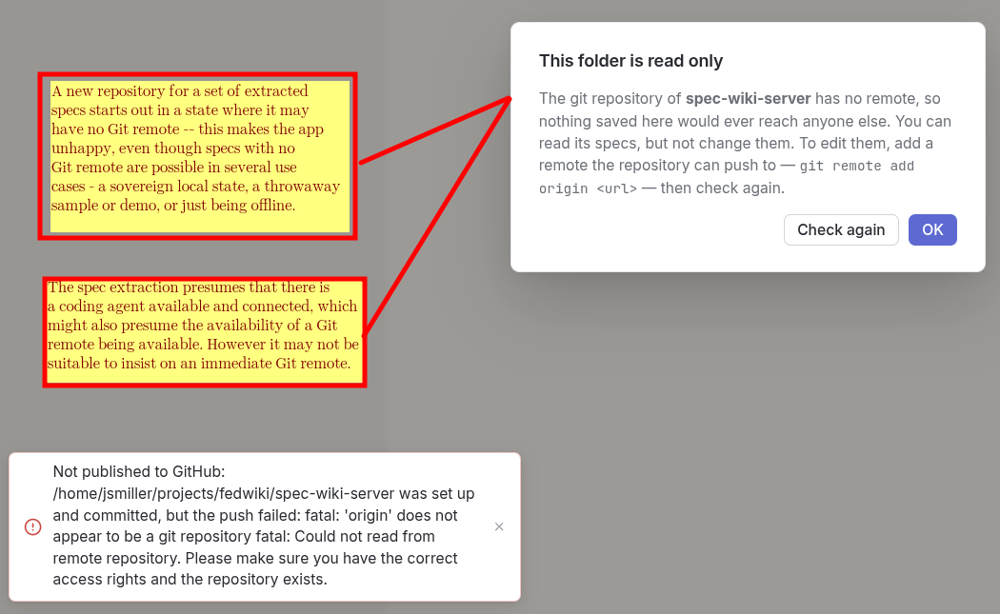
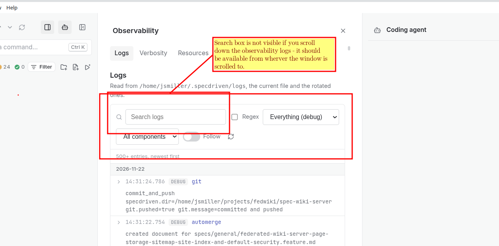

# First Impressions of Spec and Intent synthesis

**Author:** jmeowmeow

**Date:** 2026-11-22

**Kind:** Observation

DV guided JM around the inference of specs from an existing project, using the Federated Wiki wiki-server project.

The federated wiki project sorted into two modules "wiki" and "General", applying "File -> Extract Specs from Code Project"

Questions/Bumps
* SpecDriven assumes that there's a Git remote for the extracted specs -- but if we are extracting to a new repository for the first time, it's likely that (a) there's no remote established, and possible that (b) there's no remote available (offline).

* Watching the spec extraction as a conversation with the LLM is less than straightforward; it's witnessed in the "Observability" window which is reached using the panel with the user login.

* A flaw with Observability is that if you scroll to the bottom, the search widget disappears and Ctrl-F does nothing (I expected to have it pop up a "Find" dialog). We may want to make the header widgets stay in place, and/or allow keyboard shortcuts; however we should consider that keyboard shortcuts may be aliased to people's other plugins or preferences -- do we want some, and how?

