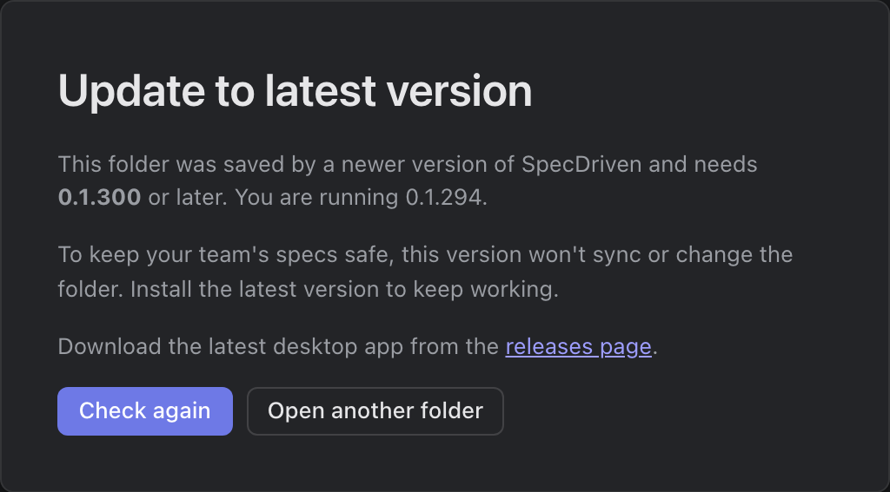

# Data format

**Updated by:** vydra

- an older app stops at data a newer app wrote, and tells the user to update

The app syncs the data folder every minute: it migrates, absorbs markdown
edits into the documents, and commits and pushes everything with
`git add -A`. An older app that half-understands newer data would rewrite it
and push the damage to the whole team, so it must notice and stop.

The data folder says which format it is in, in
`.specdriven/data-format.yaml`:

    format: 4
    minAppVersion: "0.1.296"

`format` is a number raised by hand only when a release changes the data in a
way an older release would misread — a document schema bump, a layout
migration, a new required grammar, an Automerge major upgrade. It is not the
app version, so teammates on different releases keep working together until
a real break. `minAppVersion` is the release that raised it: what the update
screen asks for. A folder with no marker is in format 1, so the marker first
appears with the first release that raises the format past 1.

Releases up to 0.1.150 predate the marker and cannot be stopped this way.
Releases before format 4 read the marker from `.specdriven/data-format.json`
instead, so that file stays beside the YAML one as a tripwire, saying the
same.

Formats so far:

- 1: everything up to the scenario numbers.
- 2: scenario headings carry their position, `## S1: <name> @v1 [published]`
  (crud-feature.md "Feature file format"). An earlier release reads the
  number as part of the name and would rewrite the file without it.
- 3: a markdown file names a stored image by its path in the repo,
  `/.images/<name>` (editor/images.md "an image shows where GitHub renders
  the file"). An earlier release reads that as an edit to the body: it
  writes a published scenario's file back, and shows no image for the rest.
- 4: the project settings are in `project-settings.yaml`, and the marker in
  `.specdriven/data-format.yaml` (project-settings.feature.md "A settings file
  from before YAML is converted"). An earlier release cannot see either: it
  would make an empty `project-settings.json` and push it.

## S1: A blocked app does not push @v1 [proposed]

**Updated by:** vydra

A folder is blocked while its data is in a newer format than this app reads. The app keeps pulling the folder, and writes nothing to it or to git.

- Given: this app has a markdown edit on disk that it has not committed yet
- and a teammate on a newer app pushes a marker with a higher `format`
- When: this app's sync tick pulls that commit
- Then: the tick ends right after the pull: it does not migrate the data, import markdown edits into the documents, run the plugins' sync passes, commit, or push
- and the edit stays on disk as it is, uncommitted

While the folder is blocked:

- an API request that would write to the folder is refused with `409 app-outdated`
- the requests that write nothing to the folder still work: switching folders, Sync, sign-in, the log and the data viewer
- changes from a live-sync peer are not written to the documents or the markdown files

The folder is unblocked when it returns to a format this app reads:

- Given: the teammate reverts the marker and pushes
- When: this app's next sync tick pulls the revert
- Then: the tick runs in full, and commits and pushes the edit it had left

[test: a blocked app does not push : https://github.com/SpecDriven/specdriven-app/blob/main/tests/dataFormatGuard.test.ts#L78 ]
[test: the API refuses writes to a blocked folder and marks its reads : https://github.com/SpecDriven/specdriven-app/blob/main/tests/dataFormatGuard.test.ts#L136 ]
[test: switching folders, Sync, sign-in, the log and the data viewer still work : https://github.com/SpecDriven/specdriven-app/blob/main/tests/dataFormatGuard.test.ts#L168 ]
[test: a live-sync peer's operations are not absorbed while the folder is blocked : https://github.com/SpecDriven/specdriven-app/blob/main/tests/automerge/automergeNetsync.test.ts#L253 ]
[test: later ticks keep pulling, so a rolled-back folder syncs again : https://github.com/SpecDriven/specdriven-app/blob/main/tests/dataFormatGuard.test.ts#L99 ]
[test: a folder rolled back to this format is unblocked : https://github.com/SpecDriven/specdriven-app/blob/main/tests/dataFormat.test.ts#L134 ]

## S2: A newer Automerge document is refused @v1 [proposed]

- Given: a feature, page or test-management document whose `schemaVersion`
  is newer than this app reads — from git, or from a live-sync peer
- When: the app loads it
- Then: it is not migrated, projected or saved
- and the folder is blocked as if its marker were newer, even when the
  marker says nothing

[test: a newer Automerge document is refused : https://github.com/SpecDriven/specdriven-app/blob/main/tests/dataFormat.test.ts#L180 ]
[test: a document in this app's schema loads : https://github.com/SpecDriven/specdriven-app/blob/main/tests/dataFormat.test.ts#L198 ]
[test: the data format is pinned to the schema versions : https://github.com/SpecDriven/specdriven-app/blob/main/tests/dataFormat.test.ts#L52 ]
[test: a too-new document rejects with the DataTooNewError itself : https://github.com/SpecDriven/specdriven-app/blob/main/tests/persistence/docStore.test.ts#L140 ]

## S3: Data saved by a newer app blocks App from opening @v1 [proposed]

**Updated by:** vydra

- Given: a data folder whose marker names a format newer than this app's
- When: the app starts on it, the user opens it, or a teammate's push raises
  it while the app is open
- Then: the update screen takes the place of the app

on backend:

- and `/api/state` reports `dataFormat: { ok: false, minAppVersion }`, and
  every other API answer carries the `X-SpecDriven-Data-Too-New` header, so
  the next request the page makes puts the screen up
- and a marker git left conflict markers in reads as its highest format

[test: data saved by a newer app blocks this one : https://github.com/SpecDriven/specdriven-app/blob/main/tests/dataFormat.test.ts#L126 ]
[test: data saved by a newer app blocks this one at start : https://github.com/SpecDriven/specdriven-app/blob/main/tests/dataFormatGuard.test.ts#L201 ]
[test: a marker git left conflict markers in reads as its highest format : https://github.com/SpecDriven/specdriven-app/blob/main/tests/dataFormat.test.ts#L157 ]
[test: an answer carrying the header reports the version it asks for : https://github.com/SpecDriven/specdriven-app/blob/main/tests/appOutdated.test.tsx#L76 ]
[test: an empty header still reports, with no version : https://github.com/SpecDriven/specdriven-app/blob/main/tests/appOutdated.test.tsx#L85 ]
[test: ordinary answers pass through, and stopping restores fetch : https://github.com/SpecDriven/specdriven-app/blob/main/tests/appOutdated.test.tsx#L94 ]
[test: server and client agree on the blocked-folder header : https://github.com/SpecDriven/specdriven-app/blob/main/tests/dataFormat.test.ts#L66 ]
[test: an unreadable marker is ignored : https://github.com/SpecDriven/specdriven-app/blob/main/tests/dataFormat.test.ts#L174 ]
[test: a folder in this format opens as usual : https://github.com/SpecDriven/specdriven-app/blob/main/tests/dataFormatGuard.test.ts#L213 ]

## S4: The update screen says what to install @v1 [proposed]

- Given: the update screen
- Then: it names the version the folder needs and the one running
- and on macOS and Linux it shows the `curl … install.sh | sh` line, on
  Windows the `irm … install.ps1 | iex` line, each with a Copy button, and in
  the desktop app a link to the latest release
- and "Check again" runs a sync and reopens the folder if it is no longer
  blocked
- and "Open another folder" goes to the folder chooser

[test: it names the version the folder needs and the one running : https://github.com/SpecDriven/specdriven-app/blob/main/tests/appOutdated.test.tsx#L28 ]
[test: macOS and Linux get the curl installer : https://github.com/SpecDriven/specdriven-app/blob/main/tests/appOutdated.test.tsx#L43 ]
[test: Windows gets the PowerShell installer : https://github.com/SpecDriven/specdriven-app/blob/main/tests/appOutdated.test.tsx#L49 ]
[test: the desktop app points at the latest release : https://github.com/SpecDriven/specdriven-app/blob/main/tests/appOutdated.test.tsx#L57 ]
[test: a folder that names no version still says to update : https://github.com/SpecDriven/specdriven-app/blob/main/tests/appOutdated.test.tsx#L37 ]

## S5: The format marker is written on first sync @v1 [proposed]

- Given: a data folder whose marker is older than this app's format, or that
  has none while this app's format is past 1
- When: the app's sync tick has brought it up to this format
- Then: the marker is written with this app's format and version, and rides
  the tick's commit
- and a folder with no marker — the first format — is raised to this app's
  format on its first tick, now that the format is past 1 (the scenario
  numbers); while the format was 1, no marker was written, so no repo got a
  commit that said what a missing file already said
- and a marker newer than this app's is never lowered

[test: the format marker is written on first sync : https://github.com/SpecDriven/specdriven-app/blob/main/tests/dataFormat.test.ts#L108 ]
[test: a folder in the first format is raised to this app's : https://github.com/SpecDriven/specdriven-app/blob/main/tests/dataFormat.test.ts#L76 ]
[test: a compatible tick raises a first-format folder to this app's : https://github.com/SpecDriven/specdriven-app/blob/main/tests/dataFormatGuard.test.ts#L124 ]
[test: an older marker is raised; a newer one is never lowered : https://github.com/SpecDriven/specdriven-app/blob/main/tests/dataFormat.test.ts#L116 ]
[test: a folder with no marker is in the first format : https://github.com/SpecDriven/specdriven-app/blob/main/tests/dataFormat.test.ts#L70 ]

## S6: An app from before YAML stops at the JSON tripwire @v1 [proposed]

- Given: a data folder whose marker is `.specdriven/data-format.json`, from
  an app before format 4
- When: this app's sync tick raises the folder to its format
- Then: it writes `.specdriven/data-format.yaml` with this app's format and
  version, and writes the same into `.specdriven/data-format.json`
- and an app from before format 4, which reads only the JSON file, shows the
  update screen for this app's version instead of writing to the folder
- and until the tick converts it, the JSON marker is read as the folder's
- and when the two files disagree, the higher format is the folder's, and a
  YAML marker git left conflict markers in reads as its highest format

[test: the JSON marker of a folder from before YAML is converted, and stays as a tripwire : https://github.com/SpecDriven/specdriven-app/blob/main/tests/dataFormat.test.ts#L89 ]
[test: a folder in the first format is raised to this app's : https://github.com/SpecDriven/specdriven-app/blob/main/tests/dataFormat.test.ts#L76 ]
[test: whichever marker names the higher format is the folder's : https://github.com/SpecDriven/specdriven-app/blob/main/tests/dataFormat.test.ts#L99 ]
[test: a YAML marker git left conflict markers in reads as its highest format : https://github.com/SpecDriven/specdriven-app/blob/main/tests/dataFormat.test.ts#L142 ]
