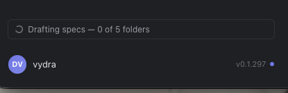
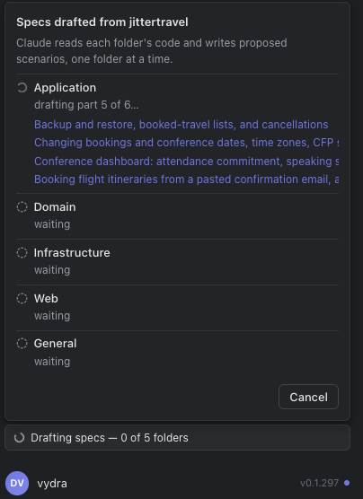
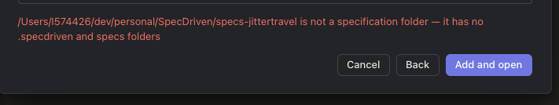

# Extract specs from a code project

**Updated by:** vydra

SpecDriven normally starts from specifications: a folder of features, written first. A team that already has code and no specifications has no way in. **Extract specs from a code project** is that way in: choose the project's folder, and the app works out its module structure, proposes folders for its specifications, makes a specification folder named `specs-<project>` beside it — with a repository on GitHub — and has an agent draft the first features from the code.

The flow is a dialog of three steps and a run in the background:

- **Project** — the folder of the code project. It is read, never written to.
- **Review** — the folders proposed from the project's build files and layout: tick the ones to make, rename them, nest one inside another, or have an agent regroup them by business area.
- **Specification folder** — a new one, with its name and the GitHub account its repository goes under, or one that already exists; and the agent that drafts.
- **Drafting** — once the new folder is open, an agent reads each chosen folder's code, one folder at a time, and writes features of `[proposed]` scenarios. A pill in the sidebar says how far it is.

Java, JavaScript, TypeScript and Python projects are read. What is extracted is a claim about intent, not a fact: every scenario is written `[proposed]`, for a person to read, correct and publish.

The specification folder is an ordinary one afterwards (spec-folders.feature.md), its project-settings.yaml naming the code project as its code repository (project-settings.feature.md).

## S1: Choose the code project @v1 [proposed]

**Updated by:** vydra

- **Given** the app on the developer's own machine
- **When** the user picks "Extract specs from code" on the first-run screen, "Extract specs from code…" under Manage folders, or "Extract specs from a code project…" in the command palette
- **Then** a dialog asks for the code project's folder — typed, or picked with Browse… — and reads it
- **And** with a code repository open, the dialog starts on that repository without asking
- **And** from the first-run screen the project opens as a code repository first, so that its agents are at hand, and the dialog starts on it
- **And** the project's languages and the number of source files are said, with files in other languages counted as not read
- **And** a folder that is not there, a path that is not absolute, and a specification folder are refused, each saying why
- **And** a project with no Java, JavaScript, TypeScript or Python code says so, and goes no further
- **And** nothing is written into the project

When import started, we see in the lower left corner:

Clicking on it, renders:

[test: proposes the project's modules and the specification folder it would get : https://github.com/SpecDriven/specdriven-app/blob/main/tests/extractRoutes.test.ts#L113 ]
[test: says so when the project holds no code it can read : https://github.com/SpecDriven/specdriven-app/blob/main/tests/extractRoutes.test.ts#L129 ]
[test: refuses a folder that is not there, a relative path and a specification folder : https://github.com/SpecDriven/specdriven-app/blob/main/tests/extractRoutes.test.ts#L145 ]
[test: the snapshot holds the files the project does not ignore, and its build files : https://github.com/SpecDriven/specdriven-app/blob/main/tests/extractRoutes.test.ts#L88 ]
[test: asks for the code project first, and says what will happen to it : https://github.com/SpecDriven/specdriven-app/blob/main/tests/extractSpecsDialog.test.tsx#L195 ]
[test: every button has the app's button look : https://github.com/SpecDriven/specdriven-app/blob/main/tests/extractSpecsDialog.test.tsx#L267 ]
[test: a code project is named by an absolute path, a leading tilde being the home folder : https://github.com/SpecDriven/specdriven-app/blob/main/tests/extractRoutes.test.ts#L446 ]

## S2: Modules from JavaScript and TypeScript workspaces @v1 [proposed]

- **Given** a JavaScript or TypeScript project
- **Then** each npm workspace (`workspaces` in package.json, array or object form), pnpm workspace (pnpm-workspace.yaml), Lerna package (lerna.json), Nx project (a folder with project.json) and tsconfig reference is proposed as a folder
- **And** a folder with a package.json of its own is a module even when no workspace lists it
- **And** a workspace glob's `*` is one folder, `**` any depth, and a `!glob` takes folders back out
- **And** a folder is named after its package — `@acme/web-ui` reads "Web UI" — and carries the package's description
- **And** each says why it is proposed: "npm workspace listed in package.json"
- **And** workspaces sorted into several folders (`apps/`, `libs/`) are grouped under those folders
- **And** a tsconfig.json with comments and trailing commas is read
- **And** a build file that does not parse is skipped, without stopping the analysis

[test: npm workspaces become folders named after their packages : https://github.com/SpecDriven/specdriven-app/blob/main/tests/intentModules.test.ts#L55 ]
[test: pnpm workspaces in several folders are grouped by folder : https://github.com/SpecDriven/specdriven-app/blob/main/tests/intentModules.test.ts#L82 ]
[test: Lerna packages, Nx projects and tsconfig references are modules too : https://github.com/SpecDriven/specdriven-app/blob/main/tests/intentModules.test.ts#L107 ]
[test: a folder with a package.json of its own is a module without any workspace : https://github.com/SpecDriven/specdriven-app/blob/main/tests/intentModules.test.ts#L126 ]
[test: workspaces are read from the array form and the object form : https://github.com/SpecDriven/specdriven-app/blob/main/tests/intentManifests.test.ts#L26 ]
[test: the name, description and entry files are read : https://github.com/SpecDriven/specdriven-app/blob/main/tests/intentManifests.test.ts#L35 ]
[test: a package.json that is not JSON reads as nothing : https://github.com/SpecDriven/specdriven-app/blob/main/tests/intentManifests.test.ts#L50 ]
[test: a star is one folder, two stars any depth, anything else itself : https://github.com/SpecDriven/specdriven-app/blob/main/tests/intentManifests.test.ts#L57 ]
[test: a negated glob takes folders back out : https://github.com/SpecDriven/specdriven-app/blob/main/tests/intentManifests.test.ts#L66 ]
[test: pnpm-workspace.yaml and lerna.json name their packages : https://github.com/SpecDriven/specdriven-app/blob/main/tests/intentManifests.test.ts#L73 ]
[test: comments and trailing commas are allowed : https://github.com/SpecDriven/specdriven-app/blob/main/tests/intentManifests.test.ts#L85 ]
[test: a comment marker inside a string is text : https://github.com/SpecDriven/specdriven-app/blob/main/tests/intentManifests.test.ts#L98 ]
[test: a directory or package name reads as words : https://github.com/SpecDriven/specdriven-app/blob/main/tests/extractSpecsDialog.test.tsx#L78 ]

## S3: Modules from Maven and Gradle builds @v1 [proposed]

- **Given** a Java project
- **Then** each Maven module is proposed as a folder — the `<module>` entries of a pom.xml, followed through the modules' own poms, a profile's modules included and a commented one not
- **And** a module is named by its pom's `<name>`, else its artifact id — its own, not its parent's or a dependency's
- **And** each Gradle project a settings.gradle or settings.gradle.kts includes is proposed: `include ':a:b'` is the folder `a/b`, `includeFlat` a sibling folder, and a `projectDir` set in the file moves a project
- **And** where the includes cannot be read, the folders that hold a build.gradle are the projects
- **And** a module that holds others is their parent folder

[test: Maven modules are followed through the modules' own poms : https://github.com/SpecDriven/specdriven-app/blob/main/tests/intentModules.test.ts#L144 ]
[test: Gradle projects come from the settings file's includes : https://github.com/SpecDriven/specdriven-app/blob/main/tests/intentModules.test.ts#L172 ]
[test: without a readable include, folders with a build.gradle are the projects : https://github.com/SpecDriven/specdriven-app/blob/main/tests/intentModules.test.ts#L188 ]
[test: the project's own coordinates are read, not its parent's or a dependency's : https://github.com/SpecDriven/specdriven-app/blob/main/tests/intentManifests.test.ts#L132 ]
[test: every module is listed, a profile's too, a commented one not : https://github.com/SpecDriven/specdriven-app/blob/main/tests/intentManifests.test.ts#L140 ]
[test: a comment pieced together around another, or left open, hides its modules too : https://github.com/SpecDriven/specdriven-app/blob/main/tests/intentManifests.test.ts#L144 ]
[test: a name that is a property is not a name : https://github.com/SpecDriven/specdriven-app/blob/main/tests/intentManifests.test.ts#L154 ]
[test: includes become folders, in Groovy and in Kotlin : https://github.com/SpecDriven/specdriven-app/blob/main/tests/intentManifests.test.ts#L160 ]
[test: an include over several lines, and a commented one : https://github.com/SpecDriven/specdriven-app/blob/main/tests/intentManifests.test.ts#L172 ]
[test: includeFlat is a sibling folder, and projectDir moves a project : https://github.com/SpecDriven/specdriven-app/blob/main/tests/intentManifests.test.ts#L177 ]

## S4: Java packages below the base package @v1 [proposed]

- **Given** a Java module that is the whole project, or holds more than 40 source files
- **Then** it is split into the packages directly below its base package — the first folder under `src/main/java` that holds a class or more than one package
- **And** each is proposed as a folder named after the package, saying "Java package under src/main/java/com/acme/shop"
- **And** classes directly in the base package stay with the module

[test: a single Java module is split into the packages below its base package : https://github.com/SpecDriven/specdriven-app/blob/main/tests/intentModules.test.ts#L204 ]

## S5: Python packages and Django apps @v1 [proposed]

- **Given** a Python project
- **Then** a uv workspace's members, and any folder with a pyproject.toml or setup.py of its own, are proposed as folders, named by the project name the file gives
- **And** a project's top-level packages are proposed — the folders with an `__init__.py` whose parent has none — looked for where pyproject.toml, setup.py or setup.cfg say the packages are (a `src` layout)
- **And** a project with one top-level package is split into that package's subpackages instead
- **And** a folder with an `apps.py` is proposed as a Django app, and says so

[test: a src layout's package is split into its subpackages : https://github.com/SpecDriven/specdriven-app/blob/main/tests/intentModules.test.ts#L234 ]
[test: Django apps are named as such : https://github.com/SpecDriven/specdriven-app/blob/main/tests/intentModules.test.ts#L259 ]
[test: uv workspace members and folders with their own pyproject are modules : https://github.com/SpecDriven/specdriven-app/blob/main/tests/intentModules.test.ts#L282 ]
[test: tables, arrays over several lines and comments are read : https://github.com/SpecDriven/specdriven-app/blob/main/tests/intentManifests.test.ts#L187 ]
[test: the name and the src layout of setuptools, Poetry and a package-dir : https://github.com/SpecDriven/specdriven-app/blob/main/tests/intentManifests.test.ts#L204 ]
[test: uv workspace members are read : https://github.com/SpecDriven/specdriven-app/blob/main/tests/intentManifests.test.ts#L215 ]
[test: setup.py and setup.cfg say where the packages are : https://github.com/SpecDriven/specdriven-app/blob/main/tests/intentManifests.test.ts#L222 ]

## S6: A project without modules falls back to its source folders @v1 [proposed]

- **Given** a project no build tool divides into modules
- **Then** the folders under its `src` (or `lib`, `app`) are proposed, each saying "Folder under src"
- **And** a folder that only sorts modules — `features`, `modules`, `domains` — is passed over for the folders inside it
- **And** a folder of shared plumbing — `utils`, `common`, `config`, `types` — is proposed unticked
- **And** a folder of code beside `src`, such as `scripts`, is proposed, ticked only when it holds five files or more
- **And** a project with no structure at all is one folder, named after the project
- **And** a module of more than 40 source files is split by its layout the same way, while a smaller one stays one folder

[test: a single-module project falls back to the folders under src : https://github.com/SpecDriven/specdriven-app/blob/main/tests/intentModules.test.ts#L300 ]
[test: a project with no structure is one folder named after it : https://github.com/SpecDriven/specdriven-app/blob/main/tests/intentModules.test.ts#L322 ]
[test: feature folders under src are proposed, not the folder that sorts them : https://github.com/SpecDriven/specdriven-app/blob/main/tests/intentModules.test.ts#L336 ]
[test: a large module is split by its layout; a small one is not : https://github.com/SpecDriven/specdriven-app/blob/main/tests/intentModules.test.ts#L390 ]

## S7: Mixed-language projects @v1 [proposed]

- **Given** a project with modules in several of the supported languages
- **Then** each module is proposed with the languages it is written in
- **And** code at the top of a project that has modules gets a folder of its own, "General", from three source files on
- **And** files in other languages are counted — "1 file of Go not read" — and never proposed
- **And** a declaration file (`.d.ts`) is not source

[test: a mixed project keeps each language's module : https://github.com/SpecDriven/specdriven-app/blob/main/tests/intentModules.test.ts#L349 ]
[test: code at the top of a project with modules gets a General folder : https://github.com/SpecDriven/specdriven-app/blob/main/tests/intentModules.test.ts#L375 ]
[test: a declaration file is not source, and other languages are not read : https://github.com/SpecDriven/specdriven-app/blob/main/tests/intentModules.test.ts#L458 ]

## S8: Tests go with their code; installed, built and generated folders are left out @v1 [proposed]

- **Given** a project with tests and with folders that are not its own code
- **Then** tests never get a folder of their own: a test belongs to the folder that holds it, or — for a tests folder apart from the code — to the folder its path or file name mirrors (`tests/billing/…`, `test_billing.py`, `BillingServiceTest.java`)
- **And** a file is a test by its folder (`src/test`, `tests`, `__tests__`, `e2e`) or its name (`*.test.*`, `*.spec.*`, `test_*.py`, `*Test.java`)
- **And** what the project ignores (.gitignore) is not read, nor anything in `node_modules`, `dist`, `build`, `target`, `vendor`, a virtual environment, a generated folder or a hidden one
- **And** a link is never followed — a `specs` link least of all
- **And** every file belongs to exactly one proposed folder: the deepest that holds it

[test: tests are told by their folder or their name, and never get a folder : https://github.com/SpecDriven/specdriven-app/blob/main/tests/intentModules.test.ts#L435 ]
[test: installed, built, generated and hidden folders are not read : https://github.com/SpecDriven/specdriven-app/blob/main/tests/intentModules.test.ts#L411 ]
[test: every file belongs to one folder, the deepest that holds it : https://github.com/SpecDriven/specdriven-app/blob/main/tests/intentModules.test.ts#L501 ]

## S9: Large projects are capped @v1 [proposed]

- **Given** a very large project
- **Then** proposed folders nest at most three deep; what would be deeper stays with the folder above it
- **And** at most 60 folders are ticked: beyond that the smallest are proposed unticked
- **And** a project of more than 50,000 files is analysed on its first 50,000
- **And** in each case the dialog says that only part of the project is proposed

[test: more folders than the limit are proposed with the smallest unticked : https://github.com/SpecDriven/specdriven-app/blob/main/tests/intentModules.test.ts#L466 ]
[test: folders nest no deeper than the limit : https://github.com/SpecDriven/specdriven-app/blob/main/tests/intentModules.test.ts#L480 ]
[test: a snapshot cut short says so : https://github.com/SpecDriven/specdriven-app/blob/main/tests/intentModules.test.ts#L495 ]

## S10: Review - tick, rename and nest folders @v1 [proposed]

- **Given** the proposed folders, each with a tick, its name, its languages, why it is proposed and how many files and tests it holds
- **When** the user ticks or unticks a folder
- **Then** everything inside it follows
- **And** a folder's name is edited in place; its path under `specs/` follows the name, and two folders of one name side by side get different paths
- **And** "Move…" puts a folder inside another, or back at the top level — never inside itself or something it holds, and no deeper than six levels
- **And** an unticked folder that holds a ticked one is still made, but no specs are drafted for it
- **And** "Tick all", "Untick all" and "Reset" act on the whole tree
- **And** Next waits until at least one folder is ticked and every folder to be made has a name

[test: starts as proposed — every folder, ticked as the analysis ticked it : https://github.com/SpecDriven/specdriven-app/blob/main/tests/extractSpecsDialog.test.tsx#L87 ]
[test: ticking a folder ticks what is inside it; nothing ticked cannot go on : https://github.com/SpecDriven/specdriven-app/blob/main/tests/extractSpecsDialog.test.tsx#L98 ]
[test: a rename changes the name and the path it is made at; a blank one cannot go on : https://github.com/SpecDriven/specdriven-app/blob/main/tests/extractSpecsDialog.test.tsx#L112 ]
[test: two folders of one name beside each other get different paths : https://github.com/SpecDriven/specdriven-app/blob/main/tests/extractSpecsDialog.test.tsx#L122 ]
[test: a folder moves into another, and back to the top : https://github.com/SpecDriven/specdriven-app/blob/main/tests/extractSpecsDialog.test.tsx#L127 ]
[test: a folder cannot move into itself, into what is inside it, or where it already is : https://github.com/SpecDriven/specdriven-app/blob/main/tests/extractSpecsDialog.test.tsx#L135 ]
[test: an unticked folder that holds a ticked one is made, but not drafted : https://github.com/SpecDriven/specdriven-app/blob/main/tests/extractSpecsDialog.test.tsx#L144 ]
[test: what a folder holds is said in a line : https://github.com/SpecDriven/specdriven-app/blob/main/tests/extractSpecsDialog.test.tsx#L156 ]
[test: a tree of folders — a tick, the name to edit, the languages, where to move it, and why it is proposed : https://github.com/SpecDriven/specdriven-app/blob/main/tests/extractSpecsDialog.test.tsx#L164 ]
[test: two folders of the same name get different spec folders : https://github.com/SpecDriven/specdriven-app/blob/main/tests/intentModules.test.ts#L540 ]

## S11: Refine regroups by business area and names only modules that exist @v1 [proposed]

- **Given** the proposed folders, which follow the code's layout
- **When** the user clicks "Refine with <agent>"
- **Then** the agent is shown one line per proposed folder — a short id, where it is, its languages and size, why it was proposed, and what its build file and README say — with the project's README, and is asked once to regroup and rename them by what the project does
- **And** the folders it answers with replace the tree: each lists the proposed folders it takes in, may sit one level inside another, and carries a sentence on what it covers
- **And** a regrouped folder owns exactly the code of the folders it lists: an id the agent made up is dropped, one used twice counts once, and folders it left out are kept under "Other"
- **And** an answer that places fewer than half the folders is refused as no regrouping
- **And** the regrouping runs in the background: the dialog says the agent is regrouping, with Stop, and an answer that arrives after Stop is not taken
- **And** "Back to the original" brings the first proposal back
- **And** when the folders were already changed by hand, the dialog asks before replacing them

[test: each proposed folder with code has a short id : https://github.com/SpecDriven/specdriven-app/blob/main/tests/intentRefine.test.ts#L58 ]
[test: a line a folder — where it is, its language and size, why it was proposed, what it says of itself : https://github.com/SpecDriven/specdriven-app/blob/main/tests/intentRefine.test.ts#L67 ]
[test: groups own the files of the folders they list, and may nest one level : https://github.com/SpecDriven/specdriven-app/blob/main/tests/intentRefine.test.ts#L97 ]
[test: an id that was not given is dropped, a repeated one counts once, and what is left out goes under Other : https://github.com/SpecDriven/specdriven-app/blob/main/tests/intentRefine.test.ts#L133 ]
[test: a parent that is not a top-level group is ignored; names are cleaned and told apart : https://github.com/SpecDriven/specdriven-app/blob/main/tests/intentRefine.test.ts#L151 ]
[test: an answer that places under half the folders, or is no answer, is refused : https://github.com/SpecDriven/specdriven-app/blob/main/tests/intentRefine.test.ts#L168 ]
[test: starts at once and ends with the regrouped folders and who made them : https://github.com/SpecDriven/specdriven-app/blob/main/tests/intentRefine.test.ts#L250 ]
[test: it can be stopped, and an answer that comes afterwards is not taken : https://github.com/SpecDriven/specdriven-app/blob/main/tests/intentRefine.test.ts#L274 ]
[test: the turn runs in the project, reads its READMEs, and answers with who regrouped : https://github.com/SpecDriven/specdriven-app/blob/main/tests/intentRefine.test.ts#L303 ]
[test: a job is asked for by its id, and stopping one that is over changes nothing : https://github.com/SpecDriven/specdriven-app/blob/main/tests/intentRefine.test.ts#L311 ]

## S12: Refine is offered only when an agent can answer @v1 [proposed]

- **Given** the review step
- **Then** "Refine with <agent>" is there only when an agent plugin that answers one-turn requests is switched on
- **And** a turn that fails, or an answer that is no regrouping, is said in the dialog with the agent named, and the tree stays as it was
- **And** a project with a single proposed folder has nothing to regroup, and says so

[test: the review lists the proposed folders, and offers the agent's regrouping where there is an agent : https://github.com/SpecDriven/specdriven-app/blob/main/tests/extractSpecsDialog.test.tsx#L207 ]
[test: a turn that fails, or an answer that is no regrouping, fails the job with the agent named : https://github.com/SpecDriven/specdriven-app/blob/main/tests/intentRefine.test.ts#L265 ]
[test: without an agent the job says so : https://github.com/SpecDriven/specdriven-app/blob/main/tests/intentRefine.test.ts#L288 ]
[test: a project of one folder has nothing to regroup, and no turn is spent : https://github.com/SpecDriven/specdriven-app/blob/main/tests/intentRefine.test.ts#L295 ]

## S13: The specification folder is made beside the project @v1 [proposed]

- **Given** the folders the user chose
- **When** the user clicks "Create and open"
- **Then** a folder named `specs-<project folder>` — or the name the user typed — is made beside the code project
- **And** it is set up as a specification folder: `.specdriven`, `specs`, the data format marker, a project-settings.yaml and a README that says what the folder is
- **And** the folder opens in this window, in place of what was open
- **And** nothing is written into the code project

[test: makes the specification folder beside the project, set up and pointing back at it : https://github.com/SpecDriven/specdriven-app/blob/main/tests/extractRoutes.test.ts#L175 ]
[test: a project's specification folder is specs-<project>, in characters a repository takes : https://github.com/SpecDriven/specdriven-app/blob/main/tests/extractSpecsDialog.test.tsx#L62 ]
[test: it is named after the project and goes beside it, wherever the project is : https://github.com/SpecDriven/specdriven-app/blob/main/tests/extractRoutes.test.ts#L434 ]
[test: the specification folder is a new one beside the project, named after it, unless one is there already : https://github.com/SpecDriven/specdriven-app/blob/main/tests/extractSpecsDialog.test.tsx#L219 ]

## S14: A name that is taken is refused @v1 [proposed]

- **Given** the specification folder's name
- **Then** a name GitHub would not take for a repository is refused as it is typed: letters, digits, dots, dashes and underscores only, at most 100 characters, not ending in `.git`
- **And** when something already sits at the place, the folder is not made: another name is asked for
- **And** when a specification folder already sits there, the dialog says so and offers "Add to it instead"
- **And** the code project's own folder cannot be its specification folder

[test: a name that is taken is refused, a specification folder there named as one : https://github.com/SpecDriven/specdriven-app/blob/main/tests/extractRoutes.test.ts#L226 ]
[test: a name a repository cannot have is refused : https://github.com/SpecDriven/specdriven-app/blob/main/tests/extractRoutes.test.ts#L238 ]
[test: a specification folder that is already there is reported : https://github.com/SpecDriven/specdriven-app/blob/main/tests/extractRoutes.test.ts#L139 ]
[test: a name a repository cannot have is said why : https://github.com/SpecDriven/specdriven-app/blob/main/tests/extractSpecsDialog.test.tsx#L68 ]
[test: the code project's own folder cannot be its specification folder : https://github.com/SpecDriven/specdriven-app/blob/main/tests/extractRoutes.test.ts#L457 ]

## S15: Add to a specification folder that already exists @v1 [proposed]

- **Given** the Specification folder step, which asks where the specifications go: "A new specification folder" or "An existing specification folder"
- **When** the user picks the existing one and names it — a folder on this computer, typed or picked with Browse…, or a repository's GitHub url — and clicks "Add and open"
- **Then** the chosen folders are added to that folder, and it opens in this window; a repository named by its url is cloned first, where the app keeps its clones, and opens by its url
- **And** what the folder holds stays as it is: its README, its features, and the display name of a spec folder that was already there
- **And** the code project is added to the code repositories its project-settings.yaml names; the default one stays, unless the folder named none
- **And** what was written is committed and pushed, as an edit in the folder is; no folder is made beside the project and no repository on GitHub
- **And** a project that already has a specification folder — one of its suggested name beside it, or the one its specs link points into — has "An existing specification folder" chosen and filled in when the step opens
- **And** otherwise the folder that is open is filled in, behind "A new specification folder"
- **And** only a specification folder can be added to: a folder without .specdriven and specs, one that is not there, a path that is not absolute, the code project itself, and a url that is not a GitHub repository's are refused, each saying why
- **And** a specs link that cannot be made — the project has a folder called specs of its own — is said, and the folders are added all the same
- **And** the specs are drafted from the project the dialog was opened on, which must be one of the folder's code repositories — not from its default one
- **And** nothing is drafted when the folder that is open is not the one the folders were added to

[test: the chosen folders are added, and what the folder holds stays as it is : https://github.com/SpecDriven/specdriven-app/blob/main/tests/extractRoutes.test.ts#L275 ]
[test: the code project joins the folder's code repositories, the default staying what it was : https://github.com/SpecDriven/specdriven-app/blob/main/tests/extractRoutes.test.ts#L288 ]
[test: a folder that names no code repository gets the project as its default : https://github.com/SpecDriven/specdriven-app/blob/main/tests/extractRoutes.test.ts#L301 ]
[test: the specs link is made into the existing folder when asked : https://github.com/SpecDriven/specdriven-app/blob/main/tests/extractRoutes.test.ts#L307 ]
[test: only a specification folder can be added to : https://github.com/SpecDriven/specdriven-app/blob/main/tests/extractRoutes.test.ts#L312 ]
[test: the analysis names the specification folder a project already has : https://github.com/SpecDriven/specdriven-app/blob/main/tests/extractRoutes.test.ts#L325 ]
[test: a specs link that leads nowhere useful names no specification folder : https://github.com/SpecDriven/specdriven-app/blob/main/tests/extractRoutes.test.ts#L337 ]
[test: the folder is named by its path, and opens by that path : https://github.com/SpecDriven/specdriven-app/blob/main/tests/extractRoutes.test.ts#L357 ]
[test: a specs link that cannot be made is said, and the folders are added all the same : https://github.com/SpecDriven/specdriven-app/blob/main/tests/extractRoutes.test.ts#L372 ]
[test: the repository is cloned, the folders added to it, and it opens by its url : https://github.com/SpecDriven/specdriven-app/blob/main/tests/extractPublish.test.ts#L370 ]
[test: a repository that is not a specification folder is refused : https://github.com/SpecDriven/specdriven-app/blob/main/tests/extractPublish.test.ts#L397 ]
[test: specs are drafted from the project the request names, not the folder's default one : https://github.com/SpecDriven/specdriven-app/blob/main/tests/intentExtraction.test.ts#L357 ]
[test: without a name the default one is read, and its code is not the other's : https://github.com/SpecDriven/specdriven-app/blob/main/tests/intentExtraction.test.ts#L366 ]
[test: a project that is not one of the folder's is not read : https://github.com/SpecDriven/specdriven-app/blob/main/tests/intentExtraction.test.ts#L373 ]
[test: nothing is drafted into a folder other than the one the folders were made in : https://github.com/SpecDriven/specdriven-app/blob/main/tests/intentExtraction.test.ts#L381 ]
[test: a project that already has a specification folder is offered that one to add to : https://github.com/SpecDriven/specdriven-app/blob/main/tests/extractSpecsDialog.test.tsx#L232 ]
[test: the folder that is open is filled in as the existing one, without being chosen : https://github.com/SpecDriven/specdriven-app/blob/main/tests/extractSpecsDialog.test.tsx#L248 ]

## S16: Published to GitHub @v1 [proposed]

- **Given** a GitHub sign-in — the app's own, or the GitHub CLI's when that is the Git access
- **Then** "Create a repository on <host>" is ticked, with the account it goes under: first the owner of the code project's own GitHub repository, then the account signed in, then its organisations — on the code project's host, a GitHub Enterprise one included
- **And** the repository is private unless Private is unticked
- **When** the folder is created
- **Then** a repository of the folder's name is made under that account, the folder starts as its clone, and what is set up in it is pushed as one commit, "Set up specifications for <project>"
- **And** the repository's description names the project
- **And** a repository of that name that holds nothing but its first commit is taken as it is; one that holds someone's work is refused
- **And** the owner and host a request names are checked before anything is made

[test: the account signed in, then its organisations : https://github.com/SpecDriven/specdriven-app/blob/main/tests/extractPublish.test.ts#L165 ]
[test: the owner of the code project's own repository comes first : https://github.com/SpecDriven/specdriven-app/blob/main/tests/extractPublish.test.ts#L170 ]
[test: the analysis carries them for the dialog : https://github.com/SpecDriven/specdriven-app/blob/main/tests/extractPublish.test.ts#L187 ]
[test: an account's own goes to /user/repos, an organisation's to /orgs : https://github.com/SpecDriven/specdriven-app/blob/main/tests/extractPublish.test.ts#L196 ]
[test: one that holds someone's work is refused; one with only its first commit is taken : https://github.com/SpecDriven/specdriven-app/blob/main/tests/extractPublish.test.ts#L206 ]
[test: the folder is a clone of the new repository, set up and pushed in one commit : https://github.com/SpecDriven/specdriven-app/blob/main/tests/extractPublish.test.ts#L244 ]
[test: a repository's owner and host are checked before anything is made : https://github.com/SpecDriven/specdriven-app/blob/main/tests/extractPublish.test.ts#L426 ]
[test: no repository unless asked for; a private one unless it says otherwise : https://github.com/SpecDriven/specdriven-app/blob/main/tests/extractRoutes.test.ts#L464 ]

## S17: Without GitHub the folder stays local and can be published later @v1 [proposed]

- **Given** no GitHub sign-in, a sign-in that may not create repositories, or "Create a repository" unticked
- **Then** the folder is made on this computer all the same, and the reason GitHub gave is said in GitHub's own words
- **And** a folder on this computer only offers "Publish to GitHub…" — in the drafting pill's list and in the command palette
- **When** the user publishes it later
- **Then** the repository is made and the folder becomes its working copy, with everything it holds by then committed and pushed
- **And** asking again for a folder that is already published only pushes
- **And** a folder that is already a repository pushing somewhere else is not published again

[test: without a sign-in, the answer says so : https://github.com/SpecDriven/specdriven-app/blob/main/tests/extractPublish.test.ts#L176 ]
[test: a refusal is worded for the dialog : https://github.com/SpecDriven/specdriven-app/blob/main/tests/extractPublish.test.ts#L218 ]
[test: when GitHub refuses, the folder is made on this computer and the reason is said : https://github.com/SpecDriven/specdriven-app/blob/main/tests/extractPublish.test.ts#L276 ]
[test: a folder left on this computer is published later, with what it holds by then : https://github.com/SpecDriven/specdriven-app/blob/main/tests/extractPublish.test.ts#L293 ]
[test: an open folder on this computer is offered the accounts it could be published under : https://github.com/SpecDriven/specdriven-app/blob/main/tests/extractPublish.test.ts#L312 ]
[test: publishing later refuses a repository that holds someone's work : https://github.com/SpecDriven/specdriven-app/blob/main/tests/extractPublish.test.ts#L334 ]
[test: Publish to GitHub is a modal dialog that waits for the accounts : https://github.com/SpecDriven/specdriven-app/blob/main/tests/extractSpecsDialog.test.tsx#L372 ]
[test: a folder that already pushes somewhere else is not published again : https://github.com/SpecDriven/specdriven-app/blob/main/tests/extractPublish.test.ts#L325 ]
[test: once published, the folder is published from then on : https://github.com/SpecDriven/specdriven-app/blob/main/tests/extractionProgress.test.tsx#L205 ]

## S18: The code project is linked in project-settings.yaml; the specs link is optional @v1 [proposed]

- **Given** the new specification folder
- **Then** its project-settings.yaml names the code project as its code repository, by a path relative to the folder (`../<project>`), so that it holds for a teammate with the two side by side
- **And** "Add a specs link to the code project" is unticked: ticked, a `specs` link to the new folder's specs is made in the code project — the only thing ever written there
- **And** a link that cannot be made — something already sits at `specs` — is said, and the folder is made all the same

[test: makes the project's specs link when asked : https://github.com/SpecDriven/specdriven-app/blob/main/tests/extractRoutes.test.ts#L195 ]
[test: a link that cannot be made is reported, and the folder is still made : https://github.com/SpecDriven/specdriven-app/blob/main/tests/extractRoutes.test.ts#L202 ]

## S19: Chosen folders are created with their names and order @v1 [proposed]

- **Given** the folders chosen in the review
- **Then** each is made under `specs/` at its path, nested ones under their parents
- **And** each gets its display name, unless the name is the folder's own
- **And** the order of the review is kept where it is not the order by name
- **And** the server makes only folders that draw on code its own analysis of the project found, each piece of code in at most one folder: a path a page sends is never trusted
- **And** a folder that is already there keeps its display name

[test: nested folders are made under their parents : https://github.com/SpecDriven/specdriven-app/blob/main/tests/extractRoutes.test.ts#L209 ]
[test: folders may only draw on code the project has, each piece once : https://github.com/SpecDriven/specdriven-app/blob/main/tests/extractRoutes.test.ts#L245 ]
[test: are slug paths, each named once : https://github.com/SpecDriven/specdriven-app/blob/main/tests/extractRoutes.test.ts#L398 ]
[test: draw on each analysed folder at most once : https://github.com/SpecDriven/specdriven-app/blob/main/tests/extractRoutes.test.ts#L408 ]
[test: a folder with no code of its own is made but not drafted : https://github.com/SpecDriven/specdriven-app/blob/main/tests/extractRoutes.test.ts#L417 ]
[test: folders already there keep their names, and an order by name writes no order file : https://github.com/SpecDriven/specdriven-app/blob/main/tests/extractRoutes.test.ts#L477 ]

## S20: A folder's code is read within a budget @v1 [proposed]

- **Given** a folder whose specs are drafted
- **Then** the agent is shown its files in this order: README and documents, API contracts (OpenAPI, protobuf, GraphQL), tests, the files a module is entered through, then the rest
- **And** each file is shown up to 12,000 characters, and one turn holds 90,000 characters of files
- **And** a folder that does not fit is split by its subfolders into several turns, each with the leading documents and the tests that go with its code, and each drafted as a feature of its own
- **And** beyond six turns the remainder is left unread, and the progress list says how many files were not read
- **And** lockfiles, minified and generated files, binaries, very large files and files in other languages are not shown
- **And** a path that leaves the project is not read
- **And** a folder with nothing that can be shown is left without a feature, and no request is made for it

[test: a file is a document, a contract, a test, a way in, or source : https://github.com/SpecDriven/specdriven-app/blob/main/tests/intentDraft.test.ts#L38 ]
[test: lockfiles, minified, generated and oversized files, and other languages, are not : https://github.com/SpecDriven/specdriven-app/blob/main/tests/intentDraft.test.ts#L49 ]
[test: a look inside tells binary, generated and minified text : https://github.com/SpecDriven/specdriven-app/blob/main/tests/intentDraft.test.ts#L57 ]
[test: a folder that fits is one batch — documents, contracts, tests, ways in, then the rest : https://github.com/SpecDriven/specdriven-app/blob/main/tests/intentDraft.test.ts#L66 ]
[test: a folder with nothing to show has no batch : https://github.com/SpecDriven/specdriven-app/blob/main/tests/intentDraft.test.ts#L94 ]
[test: a large folder is split by subfolder, each batch with the documents and its own tests : https://github.com/SpecDriven/specdriven-app/blob/main/tests/intentDraft.test.ts#L99 ]
[test: past the cap of batches, the rest is left unread and named : https://github.com/SpecDriven/specdriven-app/blob/main/tests/intentDraft.test.ts#L126 ]
[test: a file counts for no more than the part of it that is shown : https://github.com/SpecDriven/specdriven-app/blob/main/tests/intentDraft.test.ts#L136 ]
[test: a flat folder too large for one turn is cut in path order : https://github.com/SpecDriven/specdriven-app/blob/main/tests/intentDraft.test.ts#L143 ]
[test: each file under its path, a long one cut, an unreadable one left out : https://github.com/SpecDriven/specdriven-app/blob/main/tests/intentDraft.test.ts#L169 ]
[test: a path that leaves the project is not read : https://github.com/SpecDriven/specdriven-app/blob/main/tests/intentDraft.test.ts#L186 ]
[test: a folder with nothing an agent could be shown is empty from the start, and no turn is spent on it : https://github.com/SpecDriven/specdriven-app/blob/main/tests/intentExtraction.test.ts#L321 ]

## S21: Features are drafted as proposed scenarios naming their source files @v1 [proposed]

- **Given** the new specification folder, open
- **Then** an agent drafts a feature for each chosen folder, one folder at a time, in the background
- **And** the agent is asked for behaviour as seen from outside — by a user, a caller, another system — in Given/When/Then bullets, taking tests as the best evidence and writing only what the files show
- **And** each answer becomes a feature file in the folder: its title, a line saying which code it was extracted from, a description, and up to twelve scenarios, every one `[proposed]`
- **And** each scenario ends with a line naming the source files it rests on
- **And** an answer with no scenarios — the files held nothing to specify — leaves the folder without a feature, with the agent's reason
- **And** a title already taken in the folder gets a number
- **And** the agent runs in the specification folder, not in the code project, and is shown the code only through the request
- **And** the agent and model are the ones chosen in the dialog

[test: each chosen folder gets a feature of proposed scenarios drafted from its code : https://github.com/SpecDriven/specdriven-app/blob/main/tests/intentExtraction.test.ts#L128 ]
[test: an answer with no scenarios leaves the folder empty, with the agent's reason : https://github.com/SpecDriven/specdriven-app/blob/main/tests/intentExtraction.test.ts#L164 ]
[test: a title already taken in the folder gets a number : https://github.com/SpecDriven/specdriven-app/blob/main/tests/intentExtraction.test.ts#L178 ]
[test: the prompt names the module, its part, and the titles already written : https://github.com/SpecDriven/specdriven-app/blob/main/tests/intentDraft.test.ts#L193 ]
[test: is one the parser reads back — proposed scenarios, in order, naming their source files : https://github.com/SpecDriven/specdriven-app/blob/main/tests/intentDraft.test.ts#L302 ]
[test: many source files are named up to a few, then counted : https://github.com/SpecDriven/specdriven-app/blob/main/tests/intentDraft.test.ts#L324 ]

## S22: Progress and cancel @v1 [proposed]

- **Given** specs being drafted
- **Then** a pill above the user corner says how far the run is: "Drafting specs — 4 of 12 folders"
- **And** it opens a list of the folders: waiting, drafting, drafted (with links to its features), nothing to specify, or failed with the reason
- **And** each feature shows in the sidebar as it is written
- **When** the user clicks Cancel
- **Then** the turn in flight is abandoned and nothing more is drafted; what was drafted stays
- **And** while a run is at work a second one is refused, and it cannot be dismissed
- **And** once a run is over, Dismiss removes the pill; the features stay

[test: cancel abandons the turn in flight; resume takes up what was not done : https://github.com/SpecDriven/specdriven-app/blob/main/tests/intentExtraction.test.ts#L232 ]
[test: a finished run is dismissed; its features stay : https://github.com/SpecDriven/specdriven-app/blob/main/tests/intentExtraction.test.ts#L297 ]
[test: the pill says how far a run is, and how it ended : https://github.com/SpecDriven/specdriven-app/blob/main/tests/extractSpecsDialog.test.tsx#L303 ]
[test: a folder's line says what came of it : https://github.com/SpecDriven/specdriven-app/blob/main/tests/extractSpecsDialog.test.tsx#L313 ]
[test: no pill without a run; with one, its label : https://github.com/SpecDriven/specdriven-app/blob/main/tests/extractSpecsDialog.test.tsx#L354 ]
[test: what is asked of it is a copy, so nothing a caller does to the answer reaches the run : https://github.com/SpecDriven/specdriven-app/blob/main/tests/intentExtraction.test.ts#L310 ]
[test: cancel, retry and dismiss on a folder that has no run : https://github.com/SpecDriven/specdriven-app/blob/main/tests/intentExtraction.test.ts#L332 ]
[test: asks once when a folder opens, and not at all without one : https://github.com/SpecDriven/specdriven-app/blob/main/tests/extractionProgress.test.tsx#L122 ]
[test: asks again when a run was just started, and tells the sidebar of each feature written : https://github.com/SpecDriven/specdriven-app/blob/main/tests/extractionProgress.test.tsx#L137 ]
[test: another folder starts from nothing : https://github.com/SpecDriven/specdriven-app/blob/main/tests/extractionProgress.test.tsx#L152 ]
[test: keeps asking while a run is at work, and stops when it is over : https://github.com/SpecDriven/specdriven-app/blob/main/tests/extractionProgress.test.tsx#L162 ]

## S23: Retry a folder; resume an interrupted run @v1 [proposed]

- **Given** a run that is over, with folders that failed, were cancelled or were never reached
- **Then** a failed or cancelled folder offers Retry, and the run offers Resume for all of them
- **And** only what is not done is drafted: a folder already drafted, or found to hold nothing to specify, is never drafted again
- **And** a run the app was closed on shows as paused on the next start, and goes on only when the user resumes it
- **And** with no agent switched on the run waits, paused, saying so, and goes on once one is there
- **And** the run's state is kept on this device, outside the specification folder, so that it is never committed

[test: a folder that fails is retried on its own; what was drafted is not drafted again : https://github.com/SpecDriven/specdriven-app/blob/main/tests/intentExtraction.test.ts#L186 ]
[test: a run the app is closed on shows as interrupted on the next start, and is resumed by hand : https://github.com/SpecDriven/specdriven-app/blob/main/tests/intentExtraction.test.ts#L256 ]
[test: with no agent the run waits, interrupted, and goes on once one is there : https://github.com/SpecDriven/specdriven-app/blob/main/tests/intentExtraction.test.ts#L280 ]
[test: a run at work is polled; one with something left can be taken up again : https://github.com/SpecDriven/specdriven-app/blob/main/tests/extractSpecsDialog.test.tsx#L333 ]
[test: the list links each drafted feature, and offers Retry for a folder that failed : https://github.com/SpecDriven/specdriven-app/blob/main/tests/extractSpecsDialog.test.tsx#L344 ]
[test: a retry that names a folder with nothing left says so : https://github.com/SpecDriven/specdriven-app/blob/main/tests/intentExtraction.test.ts#L340 ]
[test: Cancel, Retry and Dismiss go to the server, and a refusal comes back in words : https://github.com/SpecDriven/specdriven-app/blob/main/tests/extractionProgress.test.tsx#L179 ]

## S24: Answers are checked the same way for every agent @v1 [proposed]

- **Given** agents that keep to an answer's schema (Codex), and agents that only read it as words (Claude, OpenCode)
- **Then** every answer is read the same way — as structured data, or as JSON found inside the agent's words — and checked by the app
- **And** a scenario may name only files the agent was shown
- **And** names are cleaned of what a feature file would misread, repeats and empty scenarios are dropped, and the count is capped
- **And** what the agent wrote cannot pass for the file's own syntax: a heading, a test link or an open code fence in a body is made harmless
- **And** an answer that is not a draft fails the folder, with the agent named
- **And** every object in the schemas requires all its properties, so the strictest agent's schema is the same as the others'

[test: is read from a structured result, or from JSON wrapped in words : https://github.com/SpecDriven/specdriven-app/blob/main/tests/intentDraft.test.ts#L233 ]
[test: a failed turn, or an answer that is not a draft, is none : https://github.com/SpecDriven/specdriven-app/blob/main/tests/intentDraft.test.ts#L239 ]
[test: a scenario may only name files the agent was shown : https://github.com/SpecDriven/specdriven-app/blob/main/tests/intentDraft.test.ts#L246 ]
[test: names are cleaned, repeats and empty scenarios dropped, the count capped : https://github.com/SpecDriven/specdriven-app/blob/main/tests/intentDraft.test.ts#L258 ]
[test: no scenarios is an answer — there was nothing to specify : https://github.com/SpecDriven/specdriven-app/blob/main/tests/intentDraft.test.ts#L279 ]
[test: every object of the schema requires all its properties : https://github.com/SpecDriven/specdriven-app/blob/main/tests/intentDraft.test.ts#L205 ]
[test: every object of the schema requires all its properties : https://github.com/SpecDriven/specdriven-app/blob/main/tests/intentRefine.test.ts#L84 ]
[test: JSON wrapped in words is read : https://github.com/SpecDriven/specdriven-app/blob/main/tests/intentRefine.test.ts#L175 ]
[test: an answer that is not a draft fails the folder with the agent named : https://github.com/SpecDriven/specdriven-app/blob/main/tests/intentExtraction.test.ts#L208 ]

## S25: Not in the demo, the hosted app or the read-only site @v1 [proposed]

- **Given** the demo, the hosted app or the read-only site
- **Then** none of this is offered — they open no folders on the machine they run on — and the routes refuse it if asked
- **And** drafting refuses folders that draw on code the project does not have, a model that is not a model's name, and a specification folder that names no code repository

[test: is not offered in the demo or a hosted worker : https://github.com/SpecDriven/specdriven-app/blob/main/tests/extractRoutes.test.ts#L160 ]
[test: the demo : https://github.com/SpecDriven/specdriven-app/blob/main/tests/intentExtraction.test.ts#L404 ]
[test: folders that draw on code the project does not have, and a model that is not a name : https://github.com/SpecDriven/specdriven-app/blob/main/tests/intentExtraction.test.ts#L391 ]
[test: a folder that names no code repository : https://github.com/SpecDriven/specdriven-app/blob/main/tests/intentExtraction.test.ts#L397 ]
[test: an unknown job, and the demo, are refused : https://github.com/SpecDriven/specdriven-app/blob/main/tests/intentRefine.test.ts#L322 ]
[test: every one refuses a hosted worker, and the ones on an open folder go through it : https://github.com/SpecDriven/specdriven-app/blob/main/tests/extractRoutes.test.ts#L493 ]

## S26: From the desktop app's File menu @v1 [proposed]

- **Given** the desktop app
- **When** the user picks File → "Extract Specs from Code Project…"
- **Then** the dialog opens in the window in front — on the open code repository, when one is open
- **And** on the first-run screen its "Extract specs from code" choice is picked
- **And** with no window open, a new window opens on the screen that offers it

[test: File offers Extract Specs from Code Project… where the shell can start it : https://github.com/SpecDriven/specdriven-app/blob/main/tests/appMenu.test.ts#L67 ]
[test: the desktop app's menu and the page agree on the event that starts the dialog : https://github.com/SpecDriven/specdriven-app/blob/main/tests/extractRoutes.test.ts#L524 ]

## S27: Target specs repo is not initialized @v1 [proposed]

**Created by:** vydra

**Updated by:** vydra

Given: an empty repo exists and is cloned locally
When: we try to use it for extracting specs
Then: we get

Goal: ask user if this repo should be initialized and init the repo before continuing.

[test: an empty repository is asked about, and nothing is written until the user agrees : https://github.com/SpecDriven/specdriven-app/blob/main/tests/extractRoutes.test.ts#L557 ]
[test: once agreed, it is set up, the folders added, and all of it pushed as one commit : https://github.com/SpecDriven/specdriven-app/blob/main/tests/extractRoutes.test.ts#L565 ]
[test: a repository holding only what GitHub starts one with keeps its README : https://github.com/SpecDriven/specdriven-app/blob/main/tests/extractRoutes.test.ts#L585 ]
[test: a folder holding anything else, or a code repository's specs link, is still refused : https://github.com/SpecDriven/specdriven-app/blob/main/tests/extractRoutes.test.ts#L598 ]
[test: a new folder is not made over it; the answer offers to add to it instead : https://github.com/SpecDriven/specdriven-app/blob/main/tests/extractRoutes.test.ts#L609 ]
[test: an empty repository named by its url is asked about, then set up, pushed and opened by its url : https://github.com/SpecDriven/specdriven-app/blob/main/tests/extractPublish.test.ts#L405 ]
[test: an empty repository is asked about, and set up only on a yes : https://github.com/SpecDriven/specdriven-app/blob/main/tests/extractSetUp.test.tsx#L108 ]
[test: Not now leaves the folder as it is : https://github.com/SpecDriven/specdriven-app/blob/main/tests/extractSetUp.test.tsx#L125 ]
[test: set up from where the new folder would go, the yes is already given : https://github.com/SpecDriven/specdriven-app/blob/main/tests/extractSetUp.test.tsx#L134 ]
[test: an empty repository where the new folder would go is offered to set up and add to : https://github.com/SpecDriven/specdriven-app/blob/main/tests/extractSpecsDialog.test.tsx#L257 ]
