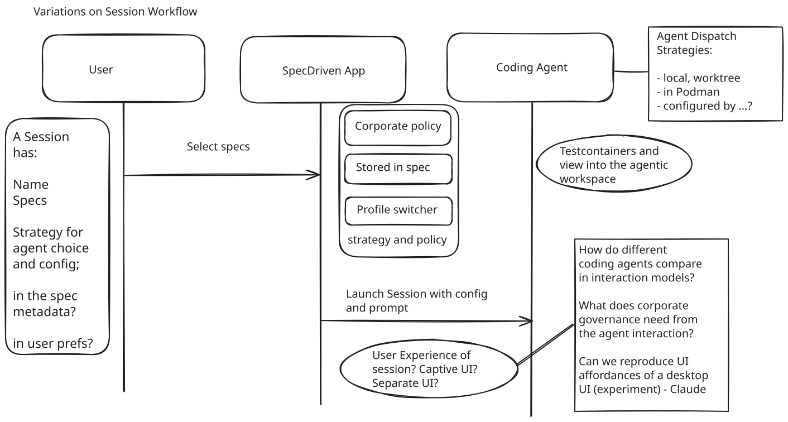

# Start Coding Session

**Created by:** jmeowmeow

**Updated by:** jmeowmeow

SpecDriven Start Coding Session Feature

Workflow: UI for starting the session.

System Behavior: Collect events, major events (start session, finish session); collect telemetry, send integration events.

Coding Session Entity
Start Session Event

* UUID
* Name
* Start Date and Time
* Type and version of the coding agent
* Session Report, consisting of:
* (nullable) End Date and Time (because Crash Only Software) 
* Token usage, input, cached, and output. (per the usual standards for LLM supplieers).
* Summary of the session.
* Linked artifacts - Git PR, Git commits, Issue(s)

Agent's Notion of a Coding Session vs. SpecDriven's Notion of a Coding Session
 - coding agents: "resume a session"
 - SpecDriven: ?

## S1: Launch Session Scenario Outline @v1 [proposed]

**Created by:** jmeowmeow

**Updated by:** jmeowmeow

1. User opens a feature file.
2. User selects the whole feature, and all of its specs, or selects one or more specs from the feature.
3. User requests a coding session.
4. SpecDriven app provides a session dialog.
5. The session dialog shows the selected specs.
6. The user may provide a name for the coding session.
7. The user confirms starting the session or cancels the session.
8. If the user does not provide a name, SpecDriven app fills in an automatically generated session name like "Session 2026-08-20 15:30:30 PDT".
9. SpecDriven app prepares a coding session prompt by combining the session name first, followed by the feature title, followed by each spec selected by the user, including the spec name and body.
10. SpecDriven app copies the coding session prompt to the system clipboard.

## S2: Run the session in Claude Code on the web @v1 [proposed]

- Given: the Start session dialog over selected specs, in the app on the
  person's own machine
- When: they pick "Claude Code on the web" under "Run in" and confirm
- Then: nothing runs on this machine: the browser opens Claude Code on the
  web (claude.ai/code) with the session prompt in the link, so it arrives
  in Claude's box — in a new tab from a browser, in the default browser
  from the desktop app
- and the option is always on offer, with no agent and no Claude app
  installed
- and the prompt gives the specifications in full and names no folder of
  this machine: the work runs in the cloud, on the repository the person
  picks there
- and the prompt is copied to the clipboard as well: one too long for a
  link opens Claude Code without it, and the note under the session button
  says to paste it
- and the choice is remembered, so the next dialog opens on it
- and the server never runs this target itself: asked to, it refuses

[test: Claude Code on the web is a target that needs nothing installed : https://github.com/SpecDriven/specdriven-app/blob/main/tests/sessionDialog.test.tsx#L63 ]
[test: Claude Code on the web is a session target the settings keep, listed for the setting alone : https://github.com/SpecDriven/specdriven-app/blob/main/tests/state.test.ts#L189 ]
[test: Claude Code on the web is remembered as the Run in choice, and never run from the server : https://github.com/SpecDriven/specdriven-app/blob/main/tests/agentSession.test.ts#L247 ]
[test: the desktop app is told apart, and on Windows its links are short : https://github.com/SpecDriven/specdriven-app/blob/main/tests/claudeWeb.test.ts#L62 ]
[test: the desktop app opens no tab ahead, and the browser only once the prompt is copied : https://github.com/SpecDriven/specdriven-app/blob/main/tests/claudeWeb.test.ts#L159 ]
[test: the desktop app pastes a long prompt, and opens nothing when it could not copy it : https://github.com/SpecDriven/specdriven-app/blob/main/tests/claudeWeb.test.ts#L172 ]
[test: the desktop app says the browser, not a tab : https://github.com/SpecDriven/specdriven-app/blob/main/tests/claudeWebNote.test.tsx#L23 ]
[test: a session in the cloud is told the specs are below, and no folder of this machine : https://github.com/SpecDriven/specdriven-app/blob/main/tests/agent.test.ts#L97 ]
[test: the prompt route builds the cloud prompt, with no folder of this machine in it : https://github.com/SpecDriven/specdriven-app/blob/main/tests/agentSession.test.ts#L313 ]

## S3: The session prompt carries the specs without their test links @v1 [proposed]

- Given: selected specs or scenarios whose scenarios carry test links, as
  `[test: … ]` lines under a scenario, a token on a rule's own line, or an
  older Tests table
- When: an AI session is started over them — the prompt copied to the
  clipboard, opened in Claude Code on the web, or run in the Claude app or
  the coding agent pane
- Then: the prompt holds each spec's heading, description and scenarios as
  written, and none of the test links: which tests automate a scenario is
  the app's bookkeeping, not part of what to build
- and a rule that carried a link on its own line keeps its words
- and a test link shown inside fenced code is part of the spec and stays
- and the spec file itself is unchanged: only the prompt goes without

[test: no session prompt carries the specs' test links : https://github.com/SpecDriven/specdriven-app/blob/main/tests/agentSession.test.ts#L281 ]
[test: the prompt carries a spec without its test links : https://github.com/SpecDriven/specdriven-app/blob/main/tests/agent.test.ts#L71 ]
[test: withoutTestLinks drops every test link and keeps the rest of the spec : https://github.com/SpecDriven/specdriven-app/blob/main/tests/parser.test.ts#L398 ]
[test: withoutTestLinks hands a spec with no test link back as it is : https://github.com/SpecDriven/specdriven-app/blob/main/tests/parser.test.ts#L445 ]
